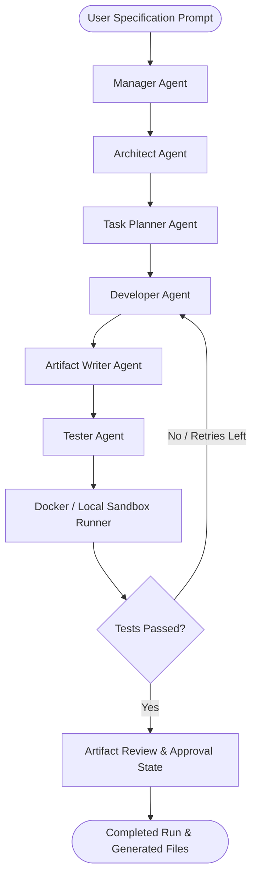

# CodeForge AI — Autonomous Multi-Agent Software Engineering Platform

[](https://fastapi.tiangolo.com)
[](https://nextjs.org)
[](https://github.com/langchain-ai/langgraph)
[](https://platform.deepseek.com)
[](#testing--verification)
[](https://python.org)
[](https://nodejs.org)

CodeForge AI is a production-grade autonomous multi-agent platform designed to automate end-to-end software engineering workflows. Given a natural language problem specification, an ensemble of specialized autonomous agents collaborates using **LangGraph** to analyze requirements, architect system designs, plan task dependency graphs (DAGs), generate production code, persist verified workspace artifacts, and execute automated tests in an isolated sandbox.

---

## Table of Contents

- [Overview & What It Does](#overview--what-it-does)
- [Multi-Agent Architecture](#multi-agent-architecture)
- [Agent Roles & Responsibilities](#agent-roles--responsibilities)
- [Technical Requirements](#technical-requirements)
- [API Keys & Configuration](#api-keys--configuration)
- [Quick Start Guide](#quick-start-guide)
  - [1. Single-Command Launch (WSL / Linux / macOS)](#1-single-command-launch-wsl--linux--macos)
  - [2. Single-Command Launch (Windows PowerShell)](#2-single-command-launch-windows-powershell)
  - [3. Docker Compose (Full Stack)](#3-docker-compose-full-stack)
  - [4. Manual Host Execution](#4-manual-host-execution)
- [Live Demonstration Guide](#live-demonstration-guide)
- [REST API Endpoints](#rest-api-endpoints)
- [Testing & Verification](#testing--verification)
- [Project Directory Structure](#project-directory-structure)

---

## Overview & What It Does

Traditional code generation models output standalone snippets with no architectural context, dependency awareness, or execution verification. **CodeForge AI solves this by introducing a cooperative multi-agent state machine:**

1. **Autonomous Requirement Decomposition**: Translates high-level prompts into granular engineering tasks.
2. **Architecture Specification**: Defines module boundaries, schemas, file trees, and endpoint contracts before writing code.
3. **Iterative Code Synthesis**: Agents write discrete files conforming strictly to the architectural plan.
4. **Automated Verification**: Automatically composes pytest test suites and executes them in an isolated test runner.
5. **Human-in-the-Loop Review**: Persists generated artifacts and provides a Next.js web dashboard where developers can inspect code, review test reports, and approve or reject runs.

---

## Multi-Agent Architecture

The core orchestration engine is built on **LangGraph**, representing workflows as a stateful cyclic graph:



---

## Agent Roles & Responsibilities

| Agent / Component | Technology | Primary Function |
|---|---|---|
| **Manager Agent** | LangGraph StateNode | Oversees the overall run lifecycle, interprets the user prompt, and initializes the workflow state. |
| **Architect Agent** | DeepSeek LLM | Formulates technical system specifications, module hierarchies, database schemas, and API contracts. |
| **Task Planner** | DeepSeek LLM | Constructs a directed acyclic graph (DAG) of programming tasks ordered by dependency. |
| **Developer Agent** | DeepSeek LLM | Generates clean, type-annotated application code matching each task specification. |
| **Artifact Writer** | Python File IO | Writes, validates, and manages file paths in the generated workspace without path traversal vulnerabilities. |
| **Tester Agent** | DeepSeek LLM | Generates comprehensive pytest unit and integration tests based on the architecture specification. |
| **Sandbox Runner** | Docker / Subprocess | Executes the generated test suite inside a restricted sandbox (no network, non-root user, memory/CPU limits). |
| **Workflow Run Service** | SQLAlchemy / SQLite / Postgres | Tracks and persists run metadata, stage transitions, agent outputs, and approval decisions. |

---

## Technical Requirements

### 1. Hardware & Operating System
- **Supported OS**: Windows 10/11 (native x86 or ARM64 with WSL2), Ubuntu/Debian Linux, macOS (Apple Silicon or Intel).
- **Architecture**: `x86_64` (AMD/Intel) natively supported; `ARM64` supported natively on Linux/macOS and via WSL2 on Windows.
- **Memory**: Minimum 4 GB RAM (8 GB recommended).

### 2. Software Dependencies
- **Python**: `>= 3.11, < 3.12`
- **Package Manager**: [uv](https://astral.sh/uv) (`>= 0.13.0`)
- **Node.js**: `>= 20.0.0` (tested on Node 20, 22, and 24)
- **Package Manager**: npm (`>= 10.0.0`)
- **Database**: SQLite (default zero-config fallback) or PostgreSQL (`16+`)
- **Docker** *(Optional)*: Required only if you build the restricted container sandbox runner image.

---

## API Keys & Configuration

The application requires **only one API key**: `DEEPSEEK_API_KEY`.

### Setting up `.env`:
Copy the example file to `.env` in the project root:
```bash
cp .env.example .env
```

Edit `.env` with your settings:
```env
# Application
CODEFORGE_ENVIRONMENT=development
CODEFORGE_DEBUG=true
CODEFORGE_LOG_LEVEL=INFO
CODEFORGE_CORS_ORIGINS=http://localhost:3000,http://127.0.0.1:3000

# Frontend API URL
NEXT_PUBLIC_API_BASE_URL=http://localhost:8000/api/v1

# Database (SQLite fallback enables instant local runs without PostgreSQL)
CODEFORGE_DATABASE_URL=sqlite:///./codeforge.db

# LLM Provider
CODEFORGE_LLM_PROVIDER=deepseek
CODEFORGE_LLM_MODEL=deepseek-chat
DEEPSEEK_API_KEY=sk-your-deepseek-api-key-here
```

> **Note:** Without an API key, the full UI, database, health checks, project creation, and all 131 test cases still work. The key is only invoked when starting a live agent workflow run.

---

## Quick Start Guide

### 1. Single-Command Launch (WSL / Linux / macOS)

A preconfigured dev script is provided that cleans ports, starts the FastAPI backend, and starts the Next.js frontend concurrently:

```bash
# On Linux, macOS, or from Windows via WSL:
./scripts/run-dev.sh
```

Or invoke from Windows PowerShell into WSL:
```powershell
wsl bash -lc "cd /mnt/c/Users/sharm/OneDrive/Desktop/OpenCode && ./scripts/run-dev.sh"
```

Access the application:
- **Frontend Dashboard**: [http://localhost:3000](http://localhost:3000)
- **Backend API & Swagger Docs**: [http://127.0.0.1:8000/docs](http://127.0.0.1:8000/docs)

---

### 2. Single-Command Launch (Windows PowerShell)

For native Windows hosts (x86_64 PCs with Python 3.11 and Node):
```powershell
powershell -ExecutionPolicy Bypass -File .\run-dev.ps1
```

---

### 3. Docker Compose (Full Stack)

To run the complete production stack (PostgreSQL 16 + FastAPI Backend + Next.js Frontend) in isolated containers:
```bash
docker compose up --build
```

---

### 4. Manual Host Execution

If you prefer separate terminal windows:

**Terminal 1 — Backend:**
```bash
cd backend
uv sync --all-groups
CODEFORGE_DATABASE_URL="sqlite:///./codeforge.db" uv run uvicorn app.main:app --reload --host 0.0.0.0 --port 8000
```

**Terminal 2 — Frontend:**
```bash
cd frontend
npm install
npm run dev -- --port 3000
```

---

## Live Demonstration Guide

Follow this walkthrough when presenting to evaluators, instructors, or teammates:

1. **Verify Backend Health**:
   - Open [http://127.0.0.1:8000/docs](http://127.0.0.1:8000/docs).
   - Execute `GET /api/v1/health`.
   - Point out the response: `{"status": "ok", "service": "CodeForge AI", "version": "0.1.0"}`.

2. **Demonstrate Project Creation**:
   - Open [http://localhost:3000](http://localhost:3000).
   - Enter a project name (e.g., *"Inventory Management Service"*) and a description.
   - Click **Create Project**. Notice the real-time project card creation.

3. **Demonstrate Multi-Agent Run Submission**:
   - Click into the project.
   - Enter a natural language feature prompt (e.g., *"Build an endpoint for stock replenishment with threshold alerts"*).
   - Click **Start Run**.
   - Review how the state machine transitions across agents and generates artifacts.

4. **Demonstrate Automated Code Quality**:
   - In your terminal, run the backend test suite:
     ```bash
     cd backend && uv run pytest
     ```
   - Highlight **131 tests passing** across API routes, architecture validators, developer agents, and workflow progression.

---

## REST API Endpoints

| Method | Endpoint | Description |
|---|---|---|
| `GET` | `/api/v1/health` | Service health status, environment, and version info |
| `POST` | `/api/v1/projects` | Create a new software project workspace |
| `GET` | `/api/v1/projects` | List all tracked software projects |
| `GET` | `/api/v1/projects/{id}` | Retrieve details of a specific project |
| `POST` | `/api/v1/workflow-runs` | Submit a prompt to start a multi-agent workflow run |
| `GET` | `/api/v1/workflow-runs/{id}` | Get status and stage progression of a workflow run |
| `GET` | `/api/v1/workflow-runs/{id}/artifacts` | Retrieve all files generated by the agents |
| `POST` | `/api/v1/workflow-runs/{id}/approval` | Record an approve or reject decision on generated code |

Interactive OpenAPI documentation is available live at `http://127.0.0.1:8000/docs` or `http://127.0.0.1:8000/redoc`.

---

## Testing & Verification

The project includes verification across both backend and frontend layers:

```bash
# Run all checks across the entire stack
./scripts/check.sh
```

### Individual Check Commands:
- **Backend Formatting & Linting**: `uv run ruff check . && uv run ruff format --check .`
- **Backend Strict Static Typing**: `uv run mypy app`
- **Backend Test Suite**: `uv run pytest` (131 unit and integration tests)
- **Frontend Linting & Style**: `npm run lint && npm run format:check`
- **Frontend Type Safety**: `npm run typecheck`
- **Frontend Component Tests**: `npm test` (17 Vitest suites)
- **Frontend Production Build**: `npm run build`

---

## Project Directory Structure

```text
OpenCode/
├── backend/                        # FastAPI backend service
│   ├── alembic/                    # Database migration versions
│   ├── app/
│   │   ├── agents/                 # Multi-agent implementations (Architect, Planner, Dev, Tester)
│   │   ├── api/                    # API route controllers (health, projects, workflow runs)
│   │   ├── core/                   # Typed settings, logging, and application configuration
│   │   ├── database/               # SQLAlchemy engine, session factory, and base models
│   │   ├── graph/                  # LangGraph state machine, nodes, and conditional edges
│   │   ├── models/                 # ORM entities (Project, WorkflowRun)
│   │   ├── schemas/                # Pydantic validation schemas
│   │   └── services/               # Execution service, validators, LLM adapters, sandbox
│   ├── tests/                      # 130+ unit and integration tests
│   └── pyproject.toml              # Python project metadata and dependencies
├── frontend/                       # Next.js 16 Web Dashboard
│   ├── src/app/                    # Next.js App Router pages and layouts
│   ├── src/components/             # UI components (Project cards, Workflow visualizer, Run detail)
│   ├── tests/                      # Vitest component and UI tests
│   └── package.json                # Frontend dependencies and scripts
├── scripts/
│   ├── check.sh                    # Full-stack automated verification script
│   ├── run-dev.sh                  # One-command dual-server launcher
│   └── build-sandbox-image.sh      # Docker test runner container builder
├── docker-compose.yml              # Multi-container orchestration (PostgreSQL + API + UI)
├── run-dev.ps1                     # PowerShell development launcher
├── .env.example                    # Environment variable template
└── README.md                       # Comprehensive platform documentation
```

---

## License

This project is licensed under the [MIT License](LICENSE).
